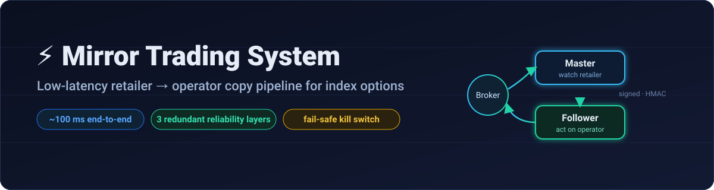
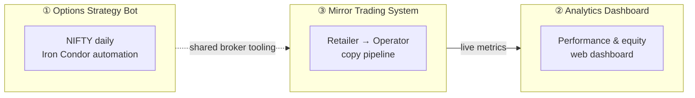
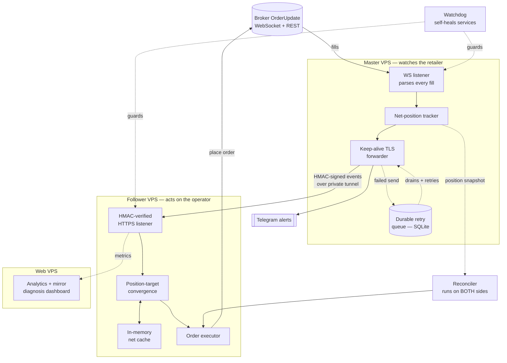
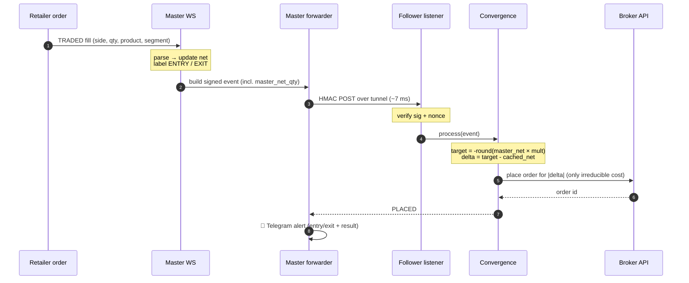
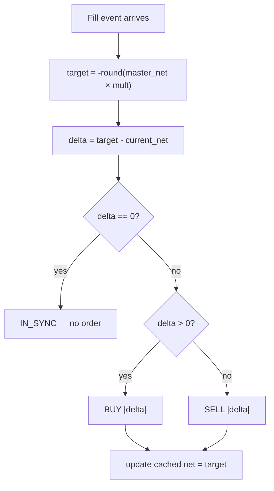
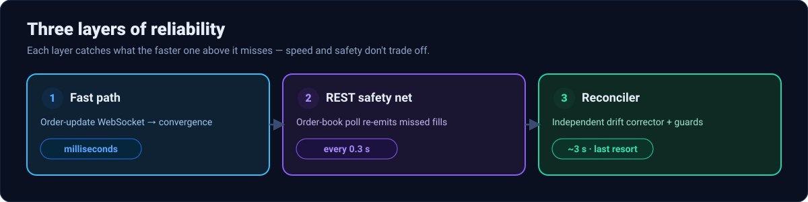
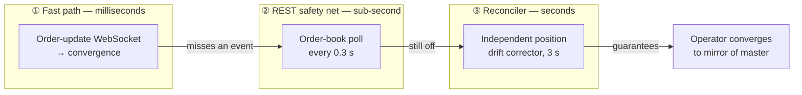
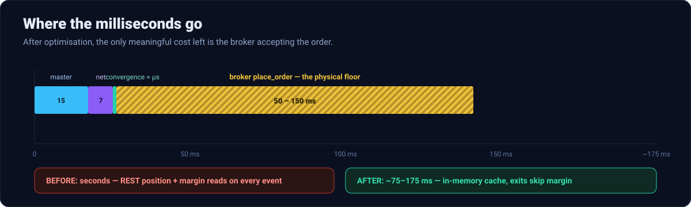
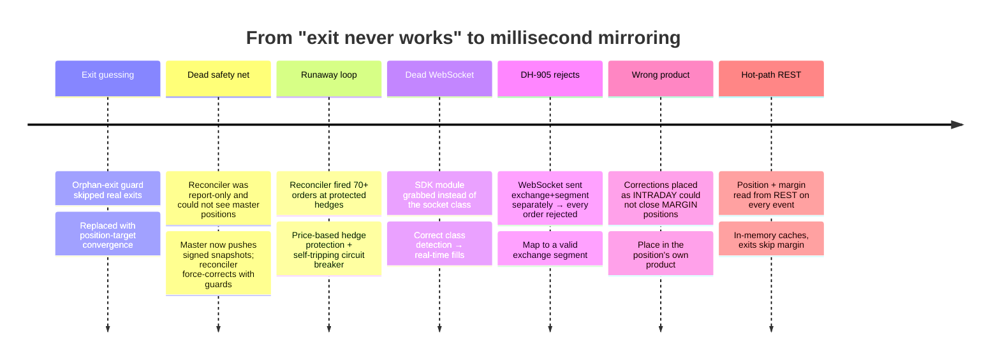

<div align="center">



# ⚡ Low-Latency Mirror Trading & Options Analytics Suite

**A production, millisecond-grade copy-trading pipeline for Indian index options — plus the analytics and alerting around it.**


</div>

> **Note on scope & secrecy.** This repository is **documentation only**. It explains the architecture, algorithms, failure modes, and engineering decisions behind the system. It contains **no credentials, no server addresses, no broker account identifiers, no tokens, and no live strategy parameters**. Infrastructure is referred to with generic roles (e.g. *Master VPS*, *Follower VPS*).

---

## 📑 Table of Contents

1. [What this system does](#-what-this-system-does)
2. [The three components](#-the-three-components)
3. [System architecture](#-system-architecture)
4. [The mirror-trading pipeline](#-the-mirror-trading-pipeline)
5. [Position-target convergence — the core algorithm](#-position-target-convergence--the-core-algorithm)
6. [Three layers of reliability](#-three-layers-of-reliability)
7. [Latency engineering](#-latency-engineering)
8. [The engineering journey — bugs found & fixed](#-the-engineering-journey--bugs-found--fixed)
9. [Safety mechanisms](#-safety-mechanisms)
10. [Human-in-the-loop Telegram alerts](#-human-in-the-loop-telegram-alerts)
11. [Tech stack](#-tech-stack)
12. [Repository layout](#-repository-layout)

---

## 🎯 What this system does

A **retailer** account places discretionary options trades. The system **mirrors every one of those trades automatically onto an operator account** at a configurable size multiplier — entering when the retailer enters and, critically, **exiting the instant the retailer exits** — while never touching the operator's own manually-placed hedge positions.

The design goals, in priority order:

| Goal | How it's met |
|------|--------------|
| **Exits are never missed** | Position-target convergence + a 3-layer redundancy stack means a flat master always drives the operator flat |
| **Millisecond execution** | Broker order-update WebSocket → persistent keep-alive forwarding → in-memory position cache on the hot path |
| **Never harm the operator's hedges** | Sub-₹5 margin-benefit legs are protected by price and never corrected |
| **Fail safe, not open** | A kill switch and a self-tripping circuit breaker stop all order placement on any anomaly |
| **A human can verify** | Every entry/exit is announced to a Telegram group with the operator's mirror result |

---

## 🧩 The three components



1. **Options Strategy Bot** — automates a daily NIFTY Iron Condor (defined-risk options structure): strike selection, entry, and management.
2. **Analytics Dashboard** — a self-contained web dashboard rendering performance, an intraday P&L curve, a capital-growth "milestone ladder," weekly/monthly returns, and risk metrics (Sharpe, drawdown, rolling win-rate).
3. **Mirror Trading System** — the heart of this document: a low-latency, fault-tolerant copy-trading pipeline across three servers.

---

## 🏗 System architecture



**Key properties**
- The two trading servers talk over an **encrypted private tunnel**; every message is **HMAC-signed** with a shared secret and carries a **timestamp + nonce** (60-second replay window).
- The forwarder holds a **pre-warmed, keep-alive TLS connection** with Nagle's algorithm disabled (`TCP_NODELAY`) for single-shot low-latency sends.
- Events are **never dropped**: a failed fast-send is persisted to a durable SQLite queue and retried by a drainer thread.

---

## 🔁 The mirror-trading pipeline

A single retailer fill travels this path:



Only **fills** (status `TRADED`) are mirrored — never resting/pending orders, because a passive limit price on the master becomes a *marketable* price when the side is flipped, which would open phantom positions.

---

## 🧮 Position-target convergence — the core algorithm

The original system tried to mirror each order by *flipping the side* and *guessing* whether it was an entry or an exit. That guessing is the classic source of the **"exit never happened"** bug — a missed or mis-classified event leaves the operator stranded in a position.

This system replaces guessing with a **convergence** model that is correct *by construction*:

```
target = -round(master_net_qty × multiplier)     # where the operator SHOULD be
delta  = target − follower_current_net           # how far off it is
order  = place |delta| on sign(delta)            # one order closes the gap
         (skip entirely if delta == 0)
```

Because the master sends its **net position after every fill**, the operator always drives toward the mirror of that net. This makes **entries, partial exits, full exits, and reversals all correct with the same three lines** — and it self-heals any single missed event, because the *next* event (or the reconciler) recomputes the gap from scratch.



| Scenario | master_net | target (×2) | follower was | action |
|----------|-----------:|------------:|-------------:|--------|
| Entry (retailer buys 1 lot) | +65 | −130 | 0 | **SELL 130** |
| Partial exit (sells half) | +32 | −64 | −130 | **BUY 66** |
| Full exit (sells rest) | 0 | 0 | −64 | **BUY 64** → flat |
| Missed the partial, see only full exit | 0 | 0 | −130 | **BUY 130** → flat (self-heals) |

---

## 🛡 Three layers of reliability





1. **Fast path** — the WebSocket delivers every fill in real time; convergence places the mirror order in milliseconds.
2. **REST poll** — if the WebSocket blips, an order-book poll every 0.3 s re-emits any fills into the same pipeline.
3. **Reconciler** — an *independent* process compares the master's real positions to the operator's every few seconds and force-corrects any drift. It is the last line of defence: even if everything else fails, the operator converges within seconds.

The reconciler only acts on a drift that **persists across two consecutive reads** (ignores mid-fill snapshots), only when the counterparty snapshot is **fresh**, and never while the kill switch is on.

---

## ⚙️ Latency engineering



Every hop on the critical path was profiled and optimised until the only remaining cost is the broker's own order API:

| Hop | Before | After | How |
|-----|-------:|------:|-----|
| Broker fill → master | — | real-time | Fixed a dead order-update WebSocket (wrong SDK class was being instantiated) |
| Master parse → forward | polled (up to 1 s) | **~15 ms** | WebSocket fast path + pre-warmed keep-alive TLS, `TCP_NODELAY` |
| Master → follower (network) | — | **~7 ms** | Persistent connection over private tunnel |
| Follower: read own position | **100–2500 ms** (REST, with retries) | **microseconds** | **In-memory net cache**, refreshed off the hot path |
| Follower: margin check | ~100–200 ms (REST every event) | **0 on exits** | Exits bypass the check (a close never needs margin); entries use a cached balance |
| Follower: place order | ~50–150 ms | ~50–150 ms | **Irreducible** — this is the broker accepting the order |

**Net result:** end-to-end mirror latency collapsed from *seconds* (polling + REST reads on the hot path) to **~75–175 ms**, dominated entirely by the broker's `place_order` round-trip — the physical floor.

---

## 🧰 The engineering journey — bugs found & fixed

This system reached reliability through a sequence of real production debugging sessions. Each fix is documented in [`docs/ENGINEERING_LOG.md`](docs/ENGINEERING_LOG.md); the highlights:



A few worth calling out:

- **"Entry works, exit never"** turned out to be *three* bugs stacked: every order was being rejected for a malformed exchange segment; the backup reconciler had tripped its circuit breaker into safe mode; and corrections were placed in the wrong product so they couldn't net off the position. The convergence math was correct the entire time — the logs proved it computed the right exit — the orders just died downstream.
- **The runaway loop** fired dozens of orders against the operator's manual hedges because the reconciler treated them as "drift." Fixed by protecting sub-₹5 legs by **price** (not product, since the retailer also trades in MARGIN product) and by a circuit breaker that freezes the system after N corrections in a window.
- **Secret hygiene throughout:** credentials always lived in git-ignored env files; this public repo was scrubbed and scanned before publishing.

---

## 🔒 Safety mechanisms

| Mechanism | Purpose |
|-----------|---------|
| **Kill switch** (a sentinel file) | Instantly blocks *all* order placement — the manual emergency brake |
| **Circuit breaker** | Auto-trips the kill switch after too many corrections in a window — makes an infinite loop impossible |
| **Confirm-twice** | A drift must persist across two reconciler cycles before any corrective order |
| **Freshness gate** | The reconciler refuses to act on a stale counterparty snapshot |
| **Hedge protection** | Positions priced under a threshold are treated as manual hedges and never touched |
| **Fills-only mirroring** | Pending/resting orders are never mirrored (avoids phantom positions) |
| **HMAC + nonce** | Every cross-server message is signed and replay-protected |
| **Watchdog + token self-reload** | Services self-heal; a rotated broker token is picked up without a restart |
| **Non-destructive deploys** | Config is backed up and auto-restored; the kill switch is held during code swaps and the prior live/frozen state is preserved |

---

## 📣 Human-in-the-loop Telegram alerts

Every retailer entry and exit is announced to a Telegram group, **with the operator's mirror result attached**, so a human can independently verify the operator actually exited:

```
🔴 EXIT (FULL — retailer now FLAT)
Retailer: SELL 1 lot NIFTY <strike> CE
Operator: ✅ operator PLACED
⚠️ Double-check the operator actually EXITED.
HH:MM:SS IST
```

Entries show 🟢, partial exits 🟠, and a failed mirror shows `❌ operator ... — NOT mirrored!`. The notifier is fire-and-forget on its own thread pool, so it never adds latency to the order path.

---

## 🧱 Tech stack

- **Language:** Python 3.11 (standard-library-first: `http.client`, `ssl`, `hmac`, `sqlite3`, `threading`)
- **Transport:** HTTPS over an encrypted private tunnel, HMAC-SHA256 signed
- **Persistence:** SQLite (durable retry queue + idempotency/dedup store)
- **Process management:** systemd units with drop-in overrides, an external watchdog, auto-restart
- **Broker integration:** official broker SDK (order-update WebSocket + REST)
- **Dashboard:** self-contained server-rendered web app (no build step), Chart.js visualisations
- **Alerting:** Telegram Bot API

---

## 📂 Repository layout

```
mirror-trading-system/
├── README.md                 ← you are here
├── docs/
│   ├── ARCHITECTURE.md        ← components, data flow, message format, deployment model
│   ├── ENGINEERING_LOG.md     ← every production bug, root cause, and fix
│   └── LATENCY.md             ← hop-by-hop latency analysis and optimisations
└── assets/                    ← SVG diagrams used in this README
```

---

<div align="center">

*Documentation prepared as a public, secret-free overview of a private trading system.*
*No credentials, server addresses, account identifiers, or live strategy parameters are included.*

</div>
