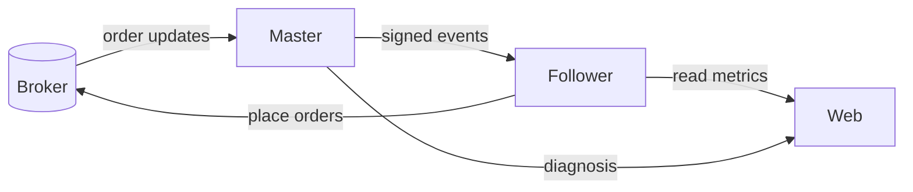

# Architecture

> Infrastructure is described by role only. No addresses, credentials, or account
> identifiers appear in this document.

## Deployment model

Three independent servers, each with a single responsibility:

| Role | Responsibility |
|------|----------------|
| **Master VPS** | Subscribes to the retailer account's order-update stream, tracks net position per instrument, and forwards fills to the follower. Never places operator orders. |
| **Follower VPS** | Receives signed events, runs convergence, and places orders on the operator account. Holds the kill switch. |
| **Web VPS** | Serves the analytics dashboard and the mirror-diagnosis/Trade-Logger UI. |

The master and follower communicate over an **encrypted private tunnel**; the web
server reaches the follower over the same tunnel for read-only metrics.



## Message format (cross-server events)

Every event is a JSON body carrying, among other fields:

| Field | Meaning |
|-------|---------|
| `master_order_id` | De-duplication key |
| `order_status` | `TRADED` / `CANCELLED` / … (only fills are mirrored) |
| `security_id`, `exchange_segment`, `symbol` | Instrument identity |
| `master_side`, `master_qty`, `master_avg_px` | The retailer's fill |
| `master_net_qty` | **The master's net position after this fill** — the basis for convergence |
| `product` | INTRADAY / MARGIN / … (mirrored exactly) |
| `action` | `ENTRY` / `EXIT_FLAT` / `EXIT_PARTIAL` / `REVERSE` (for alerts) |
| `multiplier` | Size multiplier at send time (lets config changes take effect instantly) |
| `forwarded_at` | Timestamp for latency measurement |

### Authentication

Each request carries three headers:

```
X-Mirror-Timestamp   epoch seconds
X-Mirror-Nonce       random, single-use
X-Mirror-Signature   HMAC-SHA256( secret, "{ts}\n{nonce}\n" + body )
```

The receiver recomputes the signature, rejects a timestamp outside a ±60 s
window, and rejects a replayed nonce. Reads (metrics, snapshots, corrections) use
the same scheme.

## Idempotency & delivery guarantees

- **Dedup store (SQLite):** each `(order_id, status)` is processed exactly once;
  a redelivered event returns the prior outcome rather than placing twice.
- **Durable retry queue (SQLite):** if a fast-send fails (transport error, or the
  follower returns a retryable status), the event is persisted and a drainer
  thread retries it. Events are never silently dropped.
- **Nonce table:** replay protection across restarts.

## Process supervision

- Each service runs under **systemd** with drop-in overrides for arguments.
- An **external watchdog** guards both trading services — checking a health
  endpoint on the follower and a heartbeat file on the master — and restarts a
  wedged process, with a restart-rate limit to avoid crash loops.
- **Token self-reload:** when the broker access token is rotated on schedule, the
  services detect the change on disk and reload without a full restart.

## Convergence state on the follower

```mermaid
flowchart TD
    Ev[Event or reconciler cycle] --> Read[Read follower net<br/>from in-memory cache]
    Read --> Calc["target = -round(master_net × mult)<br/>delta = target - net"]
    Calc --> Guard{Guards pass?<br/>rate · kill-switch · breaker}
    Guard -->|no| Skip[Skip + record reason]
    Guard -->|yes| Place[Place |delta| order]
    Place --> Upd[Update cached net = target]
```

The in-memory net cache is **seeded and refreshed from the broker off the hot
path**, and updated immediately on every successful placement, so the convergence
read never blocks on a network call. A short post-placement "hold" prevents a
mid-fill refresh from overwriting a just-set target.

## Deploy safety

Deployments are **non-destructive**:
1. The kill switch is engaged first, so no order can be placed during a code swap.
2. Each file is backed up on the box before it is overwritten.
3. Code is syntax-checked on the box; the WebSocket connection and the
   master→follower snapshot push are verified.
4. The kill switch is restored to its **prior** state (if the system was live
   before the deploy, it returns to live automatically).
